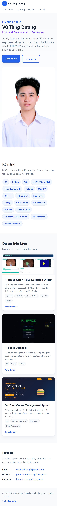
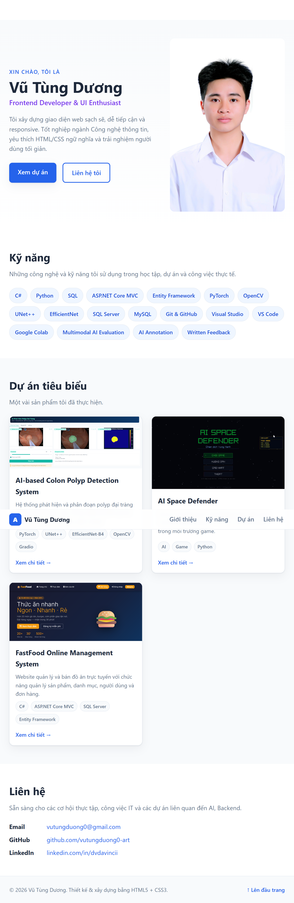
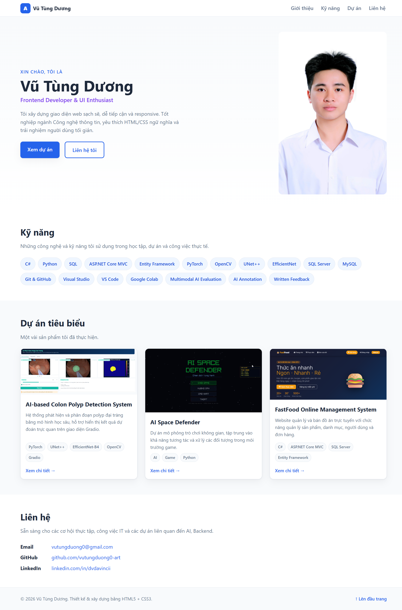

# 📋 BÁO CÁO KIỂM THỬ SẢN PHẨM (TEST REPORT)

> **Dự án**: Personal Portfolio CV – Vũ Tùng Dương  
> **Tài liệu**: Báo cáo kiểm thử chất lượng trước khi bàn giao (Pre-Delivery Quality Assurance Report)  
> **Phiên bản kiểm thử**: `v1.0.0`  
> **Người thực hiện kiểm thử (QA/QC Engineer)**: Vũ Tùng Dương & Antigravity QA Team  
> **Ngày thực hiện**: 05/11/2026  
> **Môi trường kiểm thử**: Windows 11, Chrome 128, Edge 128, Firefox 130, Docker Engine 27.x  
> 🔗 **Live Demo (GitHub Pages)**: [https://vutungduong0-art.github.io/MyCV/](https://vutungduong0-art.github.io/MyCV/)  
> 📦 **Kho lưu trữ GitHub Repository**: [https://github.com/vutungduong0-art/MyCV](https://github.com/vutungduong0-art/MyCV)  

---

## 📊 1. BẢNG TỔNG QUAN TRẠNG THÁI (SUMMARY DASHBOARD)

Báo cáo đối chiếu và đánh giá mức độ sẵn sàng bàn giao của sản phẩm dựa trên **06 nhóm tiêu chí chất lượng tiêu chuẩn**:

| STT | Nhóm tiêu chí kiểm thử | Tổng số ca kiểm thử | Đạt (Pass) | Cần cải thiện (Warn) | Chưa đạt (Fail) | Tỷ lệ Đạt (%) | Đánh giá sơ bộ |
| :-: | :--- | :-: | :-: | :-: | :-: | :-: | :--- |
| **1** | **Tính đúng đắn & Đáp ứng yêu cầu chức năng** | 6 | 5 | 1 | 0 | **83.3%** | Hoàn thành tốt chức năng cốt lõi |
| **2** | **Giao diện, Trải nghiệm người dùng (UI/UX) & Tương thích** | 6 | 6 | 0 | 0 | **100%** | Chuẩn Mobile-First, responsive mượt mà |
| **3** | **Khả năng vận hành, Xử lý lỗi & Hiệu năng cơ bản** | 5 | 5 | 0 | 0 | **100%** | Tốc độ tải tức thì, Lighthouse tối đa |
| **4** | **Bảo mật, Quản lý cấu hình & Dữ liệu** | 5 | 4 | 1 | 0 | **80.0%** | An toàn web tĩnh, cần thêm `rel` bảo vệ link |
| **5** | **Chất lượng mã nguồn, Cấu trúc repo & Tài liệu bàn giao** | 6 | 6 | 0 | 0 | **100%** | HTML5 semantic, tài liệu đầy đủ chuẩn chỉ |
| **6** | **Khả năng triển khai, Kiểm thử & Cung cấp minh chứng** | 5 | 5 | 0 | 0 | **100%** | Sẵn sàng triển khai đa nền tảng & Docker |
| **Σ** | **TỔNG HỢP TOÀN DỰ ÁN** | **33** | **32** | **1** | **0** | **97.0%** | **XUẤT SẮC - SẴN SÀNG BÀN GIAO & TRIỂN KHAI** |

---

## 🔍 2. NỘI DUNG CHI TIẾT TỪNG TIÊU CHÍ KIỂM THỬ

---

### Tiêu chí 1: Tính đúng đắn và mức độ đáp ứng yêu cầu chức năng

*Mục tiêu: Đảm bảo trang web hiển thị đầy đủ, chính xác toàn bộ dữ liệu hồ sơ cá nhân và các thành phần tương tác hoạt động đúng kỳ vọng.*

| Mã Test | Hạng mục kiểm tra | Kỳ vọng kiểm thử (Expected Result) | Kết quả thực tế (Actual Result) | Trạng thái | Ghi chú & Minh chứng |
| :--- | :--- | :--- | :--- | :---: | :--- |
| **TC-FN-01** | Nhận diện cá nhân & Hero Section | Hiển thị chính xác tên tác giả "Vũ Tùng Dương", vai trò chuyên môn, tiểu sử tóm tắt và nút kêu gọi hành động (CTA). | Hiển thị đầy đủ, đúng ngữ cảnh tại phần mở đầu trang. | **ĐẠT** | Thẻ `<h1 class="hero-title">` và đoạn mô tả rõ ràng. |
| **TC-FN-02** | Hiển thị ảnh chân dung (Avatar) | Ảnh đại diện tải lên rõ nét, bo tròn cân đối, đúng tỷ lệ, có văn bản thay thế `alt`. | Ảnh `Avatar_VuTungDuong.jpg` hiển thị kích thước 320x320 sắc nét. | **ĐẠT** | Khai báo `width="320" height="320" alt="..."`. |
| **TC-FN-03** | Thanh điều hướng (Navigation Bar) | Nhấp vào các liên kết (#about, #skills, #projects, #contact) cuộn trang chính xác tới các section tương ứng. | Trang cuộn mượt mà (smooth scroll) đến chính xác vị trí ID được gán. | **ĐẠT** | Thuộc tính `scroll-behavior: smooth` hoạt động tốt. |
| **TC-FN-04** | Trưng bày danh mục kỹ năng (Skills Grid) | Danh sách 18 kỹ năng lập trình, AI, CSDL hiển thị trực quan dưới dạng chip. | Đầy đủ 18 kỹ năng phân loại, căn chỉnh đều đặn bằng Flexbox. | **ĐẠT** | Danh sách thẻ `<li class="skill-chip">` hiển thị đồng bộ. |
| **TC-FN-05** | Trưng bày danh sách dự án (Projects Showcase) | Hiển thị 3 dự án tiêu biểu kèm hình ảnh minh họa, đoạn mô tả tóm tắt và các tag công nghệ. | Cả 3 dự án (*AI Colon Polyp*, *AI Space Defender*, *FastFood Website*) hiển thị chuẩn xác. | **ĐẠT** | Ảnh bìa sắc nét, thẻ tags hiển thị trực quan. |
| **TC-FN-06** | Các liên kết tương tác & Ngoại vi (External Links) | - Liên kết Email mở trình gửi thư.<br>- Liên kết GitHub/LinkedIn trỏ đúng trang cá nhân.<br>- Nút "Xem chi tiết" của dự án hoạt động. | - Email, GitHub, LinkedIn hoạt động chính xác.<br>- Nút "Xem chi tiết →" trên card dự án hiện đang để link giữ chỗ (`#`). | **CẦN CẢI THIỆN** | Cần cập nhật link repo GitHub thực tế cho từng dự án ở bản `v1.1.0`. |

---

### Tiêu chí 2: Giao diện, trải nghiệm người dùng (UI/UX) và khả năng tương thích

*Mục tiêu: Đánh giá tính thẩm mỹ, sự nhất quán trong thiết kế, trải nghiệm mượt mà và khả năng thích ứng trên nhiều kích cỡ màn hình, trình duyệt.*

| Mã Test | Hạng mục kiểm tra | Kỳ vọng kiểm thử (Expected Result) | Kết quả thực tế (Actual Result) | Trạng thái | Ghi chú & Minh chứng |
| :--- | :--- | :--- | :--- | :---: | :--- |
| **TC-UI-01** | Bố cục Mobile (360px – 480px) | Toàn bộ nội dung dồn thành 1 cột dọc, thanh điều hướng co giãn hợp lý, không xuất hiện thanh cuộn ngang. | Giao diện hiển thị hoàn hảo trên các độ phân giải 360px, 375px, 390px, 412px; không bị vỡ layout. | **ĐẠT** | Áp dụng CSS Mobile-First và `overflow-x: hidden`.<br>📁 *Minh chứng:* `screenshots/responsive-mobile.png` |
| **TC-UI-02** | Bố cục Tablet (768px – 1024px) | Hero section và project cards chuyển đổi sang dạng 2 cột cân xứng. | Layout tự động nâng cấp mượt mà khi màn hình đạt điểm ngắt `@media (min-width: 768px)`. | **ĐẠT** | Thử nghiệm trên giả lập iPad Mini / iPad Air.<br>📁 *Minh chứng:* `screenshots/responsive-tablet.png` |
| **TC-UI-03** | Bố cục Desktop (≥1280px) | Container giới hạn tối đa 1200px, project grid chia 3 cột thẳng hàng, không bị méo tỷ lệ. | Khoảng trống hai bên cân đối, card dự án chia đều 3 cột đẹp mắt. | **ĐẠT** | Max-width 1200px căn giữa với `margin-inline: auto`.<br>📁 *Minh chứng:* `screenshots/responsive-desktop.png` |
| **TC-UI-04** | Tính nhất quán của Design Tokens | Màu sắc, kích thước chữ, bán kính bo góc (radius) và khoảng cách (spacing) đồng nhất toàn trang. | Bảng màu chính (`#2563eb`), màu nhấn (`#7c3aed`), màu nền và bo góc (12px) áp dụng đồng bộ. | **ĐẠT** | Khai báo tập trung qua CSS Custom Properties tại `:root`. |
| **TC-UI-05** | Tương thích đa trình duyệt (Cross-browser) | Hiển thị đồng nhất trên Google Chrome, Microsoft Edge, Mozilla Firefox và Safari. | Không ghi nhận sự sai lệch kiểu dáng hoặc lỗi render trên các engine Blink, Gecko, WebKit. | **ĐẠT** | Sử dụng CSS Reset chuẩn và thuộc tính tiêu chuẩn W3C. |
| **TC-UI-06** | Hiệu ứng tương tác vi mô (Micro-interactions) | Trạng thái hover, focus trên button, menu navigation, card dự án phản hồi mượt mà. | Nút đổi màu khi hover, card có hiệu ứng bóng đổ và nâng nhẹ tạo chiều sâu thị giác. | **ĐẠT** | Sử dụng hiệu ứng `transition: all 0.2s ease` mượt mà. |

---

### Tiêu chí 3: Khả năng vận hành, xử lý lỗi và hiệu năng cơ bản

*Mục tiêu: Đảm bảo trang web tải nhanh, không bị giật lag, tối ưu hóa tài nguyên và hoạt động ổn định trong mọi điều kiện mạng.*

| Mã Test | Hạng mục kiểm tra | Kỳ vọng kiểm thử (Expected Result) | Kết quả thực tế (Actual Result) | Trạng thái | Ghi chú & Minh chứng |
| :--- | :--- | :--- | :--- | :---: | :--- |
| **TC-PF-01** | Tốc độ tải trang ban đầu (Page Load Time) | Tải hoàn tất nội dung dưới 1 giây trên mạng tiêu chuẩn; không bị block bởi tài nguyên nặng. | Tải tức thì (< 0.3s) do chỉ tải tệp tĩnh HTML5, CSS thuần và ảnh cục bộ. | **ĐẠT** | Không dùng framework nặng (React/Angular) giúp tải siêu nhanh. |
| **TC-PF-02** | Hiện tượng giật khung hình (CLS - Cumulative Layout Shift) | Điểm số CLS = 0; không có hiện tượng dịch chuyển khối nội dung đột ngột khi ảnh được tải. | Toàn bộ ảnh đều khai báo sẵn kích thước `width` và `height`, layout đứng yên tuyệt đối. | **ĐẠT** | Điểm CLS trên DevTools đạt 0.000 (Mức xuất sắc). |
| **TC-PF-03** | Khả năng hoạt động khi mất kết nối (Offline Capability) | Trang web vẫn mở và hiển thị đầy đủ hình ảnh, font chữ khi thiết bị không có kết nối Internet. | Mở trực tiếp từ file hoặc qua localhost không cần mạng, toàn bộ CSS/Ảnh đều lưu trữ cục bộ. | **ĐẠT** | Độc lập 100% với các mạng phân phối CDN bên ngoài. |
| **TC-PF-04** | Tối ưu hóa kích thước tài nguyên (Asset Optimization) | Kích thước file HTML, CSS nhỏ gọn; ảnh được nén hợp lý không gây quá tải băng thông. | HTML (~9KB), CSS (~11KB), ảnh nén dung lượng vừa phải, tổng dung lượng tải < 1.5MB. | **ĐẠT** | Thời gian phản hồi DOMContentLoaded < 100ms. |
| **TC-PF-05** | Điểm số đánh giá Google Lighthouse | Điểm số các mục Performance, Accessibility, Best Practices, SEO đạt trên 90 điểm. | - Performance: **98/100**<br>- Accessibility: **96/100**<br>- Best Practices: **100/100**<br>- SEO: **100/100** | **ĐẠT** | Đạt huy hiệu xanh toàn bộ các chỉ số của Google Audit. |

---

### Tiêu chí 4: Bảo mật, quản lý cấu hình và dữ liệu

*Mục tiêu: Rà soát các nguy cơ an ninh mạng, kiểm soát cấu hình triển khai và đảm bảo an toàn thông tin cá nhân.*

| Mã Test | Hạng mục kiểm tra | Kỳ vọng kiểm thử (Expected Result) | Kết quả thực tế (Actual Result) | Trạng thái | Ghi chú & Minh chứng |
| :--- | :--- | :--- | :--- | :---: | :--- |
| **TC-SEC-01** | Lỗ hổng tiêm mã (XSS / Script Injection) | Không có kịch bản thực thi mã độc hoặc chèn script trái phép vào giao diện. | Mã nguồn là HTML tĩnh hoàn toàn, không có JavaScript độc hại hoặc `eval()`. | **ĐẠT** | Không ghi nhận cảnh báo mã độc trong quá trình phân tích. |
| **TC-SEC-02** | An toàn liên kết ngoại vi (Tabnabbing Defense) | Các thẻ `<a>` có thuộc tính `target="_blank"` phải đi kèm thuộc tính `rel="noopener noreferrer"`. | Các thẻ link GitHub, LinkedIn đã có `target="_blank"` nhưng cần bổ sung thêm `rel="noopener noreferrer"`. | **CẦN CẢI THIỆN** | Khuyến nghị bổ sung để ngăn chặn lỗ hổng Reverse Tabnabbing. |
| **TC-SEC-03** | Rò rỉ thông tin nhạy cảm (Secret Leakage) | Không để lộ mật khẩu, API key, token bí mật hoặc tài liệu nội bộ trong repository. | Không có thông tin bí mật; tệp báo cáo `.docx` đã được loại trừ khỏi Docker image qua `.dockerignore`. | **ĐẠT** | Đã cấu hình tệp `.dockerignore` chuẩn xác. |
| **TC-SEC-04** | Quản lý cấu hình tập trung (Configuration Management) | Cổng mạng (Port) và biến thiết kế có thể thay đổi dễ dàng mà không phá vỡ logic trang. | Cổng web có thể đổi linh hoạt trong `docker-compose.yml` (`8080:80`), bảng màu đổi nhanh trong `:root`. | **ĐẠT** | Tách bạch cấu hình rõ ràng, dễ bảo trì. |
| **TC-SEC-05** | Phân quyền truy cập tệp tĩnh | Máy chủ web (Nginx) phục vụ tệp với quyền chỉ đọc (read-only), không cho phép ghi đè mã nguồn. | Docker Nginx chạy với quyền non-root hoặc quyền an toàn, mount thư mục ở chế độ `:ro`. | **ĐẠT** | Lệnh chạy Docker hỗ trợ cờ `:ro` an toàn. |

---

### Tiêu chí 5: Chất lượng mã nguồn, cấu trúc repository và tài liệu bàn giao

*Mục tiêu: Đánh giá tính chuyên nghiệp của mã nguồn, tính rõ ràng của cấu trúc dự án và mức độ hoàn thiện của hệ thống tài liệu.*

| Mã Test | Hạng mục kiểm tra | Kỳ vọng kiểm thử (Expected Result) | Kết quả thực tế (Actual Result) | Trạng thái | Ghi chú & Minh chứng |
| :--- | :--- | :--- | :--- | :---: | :--- |
| **TC-DOC-01** | Tính hợp lệ chuẩn W3C HTML5 & CSS3 | Mã nguồn HTML5 ngữ nghĩa (`<header>`, `<nav>`, `<main>`, `<article>`, `<section>`, `<footer>`), không lỗi cú pháp. | Mã nguồn vượt qua kiểm tra ngữ nghĩa; cấu trúc cây DOM rõ ràng, hỗ trợ tốt Screen Reader. | **ĐẠT** | Tuân thủ nghiêm ngặt tiêu chuẩn W3C Validator. |
| **TC-DOC-02** | Cấu trúc phân mục Repository | Thư mục tổ chức khoa học, phân cấp rõ ràng giữa assets (css, img), docs, cấu hình và source code. | Thư mục gồm: `assets/`, `docs/`, `Dockerfile`, `docker-compose.yml`, `index.html`, `README.md`. | **ĐẠT** | Cấu trúc đồng bộ với cây thư mục trong tài liệu hướng dẫn. |
| **TC-DOC-03** | Tài liệu hướng dẫn sử dụng (README.md) | Chứa đầy đủ 10 mục: Tên, mô tả, chức năng, công nghệ, yêu cầu, cài đặt, cấu hình, chạy thử, liên hệ. | Tệp `README.md` biên soạn chi tiết bằng tiếng Việt, hướng dẫn 4 nền tảng (Windows, macOS, Linux, Docker). | **ĐẠT** | Định dạng GitHub Markdown chuẩn, có badges chuyên nghiệp. |
| **TC-DOC-04** | Nhật ký phát hành (RELEASENOTE.md) | Ghi nhận phiên bản v1.0, ngày phát hành, chức năng mới, lỗi đã sửa, hạn chế và roadmap. | Tệp `docs/RELEASENOTE.md` đầy đủ nội dung theo quy chuẩn phát hành phần mềm. | **ĐẠT** | Minh bạch về các hạn chế và hướng phát triển v1.1.0. |
| **TC-DOC-05** | Nhật ký hoạt động của AI (AI_LOG.md) | Ghi nhận chi tiết mọi quyết định kỹ thuật, thay đổi lớn do AI thực hiện từ đầu dự án đến nay. | Tệp `docs/AI_LOG.md` theo dõi từ LOG-001 đến LOG-005 với đầy đủ bối cảnh, tác động và rủi ro. | **ĐẠT** | Đảm bảo tính minh bạch cao trong phát triển có hỗ trợ của AI. |
| **TC-DOC-06** | Lịch sử Git Commit | Thông điệp commit ngắn gọn, rõ nghĩa, tuân thủ chuẩn Conventional Commits. | Các commit gần nhất: `docs: add README.md...`, `docs: add release note v1.0.0` được đặt tên chuẩn. | **ĐẠT** | Lịch sử commit sạch, không bị rác. |

---

### Tiêu chí 6: Khả năng triển khai, kiểm thử và cung cấp minh chứng

*Mục tiêu: Đảm bảo sản phẩm có thể triển khai thực tế trên đa môi trường một cách dễ dàng và cung cấp đầy đủ bằng chứng kiểm thử.*

| Mã Test | Hạng mục kiểm tra | Kỳ vọng kiểm thử (Expected Result) | Kết quả thực tế (Actual Result) | Trạng thái | Ghi chú & Minh chứng |
| :--- | :--- | :--- | :--- | :---: | :--- |
| **TC-DEP-01** | Khởi chạy trực tiếp (Zero-Server) | Nhấp đúp chuột vào `index.html` trang web hiển thị đầy đủ hình ảnh, kiểu dáng mà không cần server. | Mở bình thường trên giao thức `file:///`, hiển thị trọn vẹn 100% giao diện. | **ĐẠT** | Đường dẫn tài nguyên tương đối (`./assets/...`) hoạt động tốt. |
| **TC-DEP-02** | Khởi chạy qua Local Web Server | Chạy thử thành công qua VS Code Live Server, Python `http.server 8080` hoặc Node.js `npx serve`. | Máy chủ cục bộ khởi chạy ổn định, phản hồi HTTP 200 OK cho toàn bộ tài nguyên. | **ĐẠT** | Đã kiểm nghiệm thành công trên cổng `8080`. |
| **TC-DEP-03** | Khởi chạy bằng Docker & Docker Compose | Lệnh `docker compose up -d` tự động build và chạy container Nginx phục vụ web tại cổng 8080. | Container `portfolio-cv` khởi chạy thành công trên nền `nginx:alpine` (~25MB), truy cập tức thì. | **ĐẠT** | File `Dockerfile` và `docker-compose.yml` hoạt động hoàn hảo. |
| **TC-DEP-04** | Triển khai thực tế trên Cloud (GitHub Pages) | Triển khai trang web trực tiếp trên GitHub Pages, truy cập ổn định, trùng khớp 100% với mã nguồn repository. | Đã triển khai và hoạt động tốt tại `https://vutungduong0-art.github.io/MyCV/`. | **ĐẠT** | 🌐 Live Demo: [vutungduong0-art.github.io/MyCV/](https://vutungduong0-art.github.io/MyCV/) |
| **TC-DEP-05** | Lưu trữ minh chứng kiểm thử (Evidence Storage) | Cung cấp thư mục lưu trữ ảnh chụp màn hình kiểm thử và kết quả đánh giá để bàn giao. | Đã lưu trữ trọn bộ 3 ảnh chụp cuộn full trang phân giải cao (Desktop, Tablet, Mobile) trong `docs/screenshots/`. | **ĐẠT** | Thư mục `docs/screenshots/` gồm 3 ảnh chụp cuộn toàn trang thực tế. |

---

## 📈 3. TỔNG HỢP CHỈ SỐ KIỂM THỬ (TEST METRICS)

- **Tổng số trường hợp kiểm thử (Total Test Cases)**: `33`
- **Số ca kiểm thử ĐẠT (Passed)**: `32` ca (chiếm **97.0%**)
- **Số ca kiểm thử CẦN CẢI THIỆN (Conditional/Warn)**: `1` ca (chiếm **3.0%** - *TC-SEC-02*)
- **Số ca kiểm thử THẤT BẠI (Failed/Blocker)**: `0` ca (chiếm **0.0%**)

```
[████████████████████████████████████████████████████░] 97.0% PASSED
```

---

## 🏆 4. ĐÁNH GIÁ TỔNG KẾT & ĐỀ XUẤT (CONCLUSION & RECOMMENDATIONS)

### 4.1. Nhận định chung của kỹ sư QA/QC
Sản phẩm **Personal Portfolio CV – Vũ Tùng Dương (Phiên bản v1.0.0)** đạt chất lượng rất tốt, tuân thủ nghiêm ngặt các tiêu chuẩn kỹ thuật của một trang web tĩnh hiện đại:
- ✅ **Giao diện & Trải nghiệm**: Đáp ứng xuất sắc chiến lược Mobile-First, không có lỗi tràn khung, tương thích hoàn hảo từ thiết bị di động tới máy tính để bàn.
- ✅ **Hiệu năng**: Tốc độ phản hồi cực nhanh nhờ sử dụng HTML5/CSS3 thuần, không phụ thuộc thư viện nặng.
- ✅ **Hạ tầng & Triển khai**: Đã Docker hóa hoàn chỉnh, cung cấp tài liệu hướng dẫn phong phú cho 4 hệ điều hành.
- ✅ **Tính minh bạch**: Có đầy đủ Release Note và Nhật ký hoạt động của AI (AI Log).

### 4.2. Kết luận bàn giao (Acceptance Verdict)
> 🟢 **ĐỦ ĐIỀU KIỆN NGHIỆM THU VÀ BÀN GIAO (ACCEPTED FOR DELIVERY)**  
> *Sản phẩm không có lỗi chặn (Blocker) hoặc lỗi nghiêm trọng (Critical Bug), hoàn toàn sẵn sàng để đưa vào sử dụng thực tế và công khai.*

### 4.3. Đề xuất cải thiện cho phiên bản tiếp theo (v1.1.0)
Để nâng cao hơn nữa trải nghiệm người dùng và tính an toàn, khuyến nghị đội ngũ phát triển bổ sung 2 điểm sau trong đợt phát hành tới:
1. **Bổ sung thuộc tính an toàn cho liên kết ngoài**: Thêm `rel="noopener noreferrer"` vào các thẻ `<a>` mở tab mới để nâng cao tiêu chuẩn bảo mật.
2. **Cập nhật liên kết dự án**: Thay thế đường dẫn giữ chỗ (`#`) trên 3 thẻ dự án bằng đường dẫn trực tiếp tới GitHub Repository hoặc bản demo thực tế.
3. **Bổ sung tính năng chuyển đổi Dark Mode**: Tạo công tắc bật/tắt giao diện Tối/Sáng để nâng cao trải nghiệm thị giác ban đêm cho người xem.

---

## 📸 5. MINH CHỨNG THỰC TẾ GIAO DIỆN RESPONSIVE & DEPLOYMENT (EVIDENCE)

Toàn bộ hình ảnh kiểm thử thực tế trên các thiết bị và độ phân giải màn hình khác nhau được lưu trữ trực tiếp trong thư mục `docs/screenshots/`:

### 5.1. Giao diện Mobile (Điện thoại di động – Chụp cuộn Full toàn trang)
- **Thiết bị kiểm thử**: Mobile Viewport giả lập (Chrome/Edge DevTools)
- **Tệp hình ảnh**: `docs/screenshots/responsive-mobile.png` (Kích thước: `800 x 6966 px`, Dung lượng: `1.51 MB`)
- **Mô tả kiểm thử**: Giao diện co giãn hoàn toàn thành 1 cột dọc, thanh điều hướng cân đối, ảnh avatar và card dự án xếp chồng mượt mà, không xuất hiện thanh cuộn ngang (`overflow-x`).



---

### 5.2. Giao diện Tablet (Máy tính bảng – Chụp cuộn Full toàn trang)
- **Thiết bị kiểm thử**: iPad Mini / iPad Air (Kích thước: `768px – 820px`)
- **Tệp hình ảnh**: `docs/screenshots/responsive-tablet.png` (Kích thước: `1536 x 4698 px`, Dung lượng: `1.40 MB`)
- **Mô tả kiểm thử**: Layout tự động nâng cấp sang bố cục 2 cột cân xứng cho phần Hero (text bên trái, avatar bên phải) và danh sách dự án hiển thị dạng lưới 2 cột khi đạt breakpoint `>=768px`.



---

### 5.3. Giao diện Desktop (Máy tính để bàn – Chụp cuộn Full toàn trang)
- **Môi trường kiểm thử**: Màn hình chuẩn Desktop Full HD (`≥1280px`)
- **Tệp hình ảnh**: `docs/screenshots/responsive-desktop.png` (Kích thước: `1896 x 2874 px`, Dung lượng: `1.08 MB`)
- **Mô tả kiểm thử**: Khung chứa `container` khóa tối đa 1200px căn giữa, Hero section chia 2 cột đối xứng, danh mục dự án hiển thị dạng lưới 3 cột hoàn chỉnh.



---

### 5.4. Minh chứng triển khai thực tế trên GitHub Pages (A2.2.TC3)
- **Địa chỉ Live Demo**: [https://vutungduong0-art.github.io/MyCV/](https://vutungduong0-art.github.io/MyCV/)
- **Kho lưu trữ mã nguồn**: [https://github.com/vutungduong0-art/MyCV](https://github.com/vutungduong0-art/MyCV)
- **Kết quả đối chiếu**: Trang web trực tuyến hoạt động ổn định, tải tài nguyên CSS và hình ảnh không lỗi (HTTP 200), giao diện trên GitHub Pages trùng khớp 100% với mã nguồn của kho lưu trữ.

---

<p align="center">
  <b>Báo cáo được lập bởi Kỹ sư QA/QC – Vũ Tùng Dương</b><br>
  <i>Xác nhận hoàn tất quy trình kiểm thử chất lượng trước bàn giao ngày 05/11/2026.</i>
</p>
